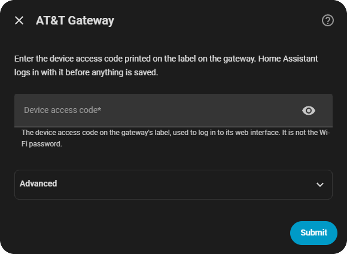
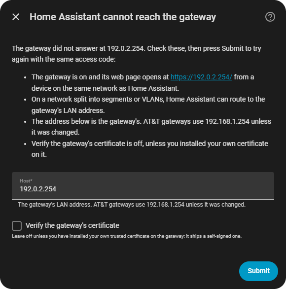
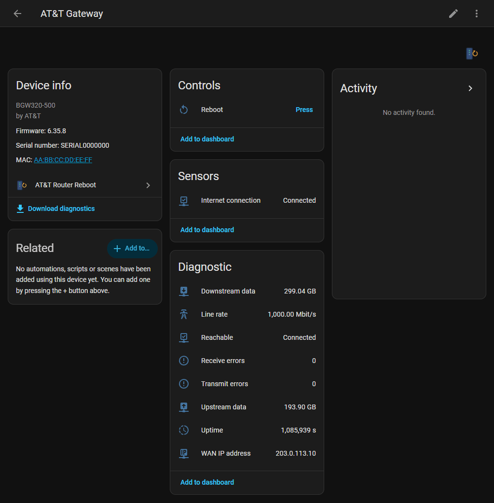

# AT&T Router Reboot for Home Assistant

Home Assistant custom integration to reboot an AT&T residential gateway on demand or on a schedule, and to watch its uptime and broadband statistics. Built against a BGW320-500 on firmware 6.35.8. Other BGW-series gateways share the same web interface; see Supported devices.

Everything talks to the gateway over your local network. No AT&T account, no cloud.

## Screenshots



Setup asks only for the device access code; the address and certificate check wait in Advanced.



When the gateway does not answer, setup lists what to check and tries again on Submit.



The device page, captured against the test suite's recorded gateway pages.

## What you get

One device, "AT&T Gateway", with these entities. All of the sensors are read from pages the gateway serves without a login, so they work even before you have entered an access code, and a wrong code never blanks them.

| Entity | Type | What it is |
|---|---|---|
| Reboot | button | Logs in to the gateway and submits its own restart form. |
| Uptime | sensor | Seconds since the gateway last booted. Resets to near zero after a reboot, which is how you can tell one worked. |
| WAN IP address | sensor | The public IPv4 address on the broadband side. |
| Line rate | sensor | The broadband link speed in Mbit/s. |
| Downstream data, Upstream data | sensor | IPv4 byte counters, shown in GB. They reset when the gateway reboots. |
| Receive errors, Transmit errors | sensor | IPv4 error counters. |
| Reachable | binary sensor | On when the gateway answered the last poll. Stays available while everything else is unavailable, so the fault is visible. |
| Internet connection | binary sensor | On when the gateway reports its broadband link up. Separate from Reachable: a gateway can answer perfectly while its upstream is down. |

Reboot and Internet connection are the dashboard entities. Everything else is diagnostic: Reachable, Uptime, the WAN address, the line rate and all of the counters.

### Actions

| Action | Does | Fields |
|---|---|---|
| `att_router_reboot.reboot` | Reboots the gateway now, the same way the button does. | None. The integration manages one gateway, so there is nothing to target. |

The action is registered when Home Assistant starts, so an automation that calls it while the integration is not loaded gets a clear "not loaded" error rather than an unknown-action error.

The action and the Reboot button are for administrators. A signed-in user who is not an administrator gets an authorization error and nothing is sent to the gateway. Automations, scripts and the built-in schedule run without a user and are unaffected.

## Supported devices

| Gateway | Firmware | Notes |
|---|---|---|
| BGW320-500 | 6.35.8 | The parser and the login are built against pages recorded from this unit. |
| BGW320-505 | any | Same web interface as the BGW320-500. |
| BGW210-700 | any | Same web interface family (`sysinfo.ha`, `broadbandstatistics.ha`, `restart.ha`). |

The gateway must serve its web interface over HTTPS on its LAN address, which every BGW does by default. If another model reads differently, open an issue with the debug log.

## Use cases

- Reboot the gateway from a dashboard button instead of walking to it.
- Reboot it on a schedule (nightly, or one night a week) without writing an automation, with a guard against rebooting a gateway that has only just come up.
- Reboot it automatically when the internet connection has been down for a while, from an automation on the Internet connection sensor.
- Know when the public IP address changes, and when the gateway rebooted on its own.

## Requirements

- Home Assistant 2026.3 or newer. The code needs Python 3.14.2, and 2026.3.0 is the first release to require it; the in-repo brand images are served from the same release on.
- An AT&T gateway reachable on your LAN, usually at `192.168.1.254`. Home Assistant must be able to reach that address - on a segmented network, put Home Assistant where it can route to the gateway.
- The device access code printed on the gateway's label. This is what its web interface logs in with. It is needed for the reboot, not for the statistics.

## Installation

[](https://my.home-assistant.io/redirect/hacs_repository/?owner=heidrickla&repository=ha-att-router-reboot&category=integration)

1. Press the button above, then Download in HACS, and restart Home Assistant when it asks.
2. Press this button to start the setup:

[](https://my.home-assistant.io/redirect/config_flow_start/?domain=att_router_reboot)

The setup asks only for the device access code on the gateway's label:

1. AT&T Gateway: type the device access code and press Submit. The integration logs in before it saves anything, so a wrong code is caught here.
2. Automatic reboot schedule: the schedule is off. Press Submit, or choose Daily or Weekly first.

The Advanced section of the first screen holds the gateway's address (`192.168.1.254`, AT&T's default) and the certificate check (off); the defaults fit a gateway as AT&T ships it. If Home Assistant cannot reach the gateway, the setup says what to check, keeps the access code, and Submit tries again.

Without the buttons: HACS, search for AT&T Router Reboot, download it and restart; then Settings, Devices & services, Add integration, AT&T Router Reboot. Manual install: copy `custom_components/att_router_reboot` into your configuration's `custom_components` folder and restart.

Only one gateway can be added to a Home Assistant instance.

### Discovery

Add the gateway by address. It offers nothing to be discovered by. A BGW320-500 in AT&T IP passthrough mode answers no SSDP search (`ssdp:all`, `upnp:rootdevice` or either InternetGatewayDevice target), serves no UPnP description on port 1900, 49152, 5000 or 80, and announces nothing over mDNS. Its web interface has no UPnP settings. It is the LAN's DHCP server rather than a client, so it never sends the DHCP request Home Assistant's DHCP discovery listens for.

### Installation parameters

| Field | Where | Default | What it is |
|---|---|---|---|
| Device access code | First screen | none, required | The code on the gateway's label. Stored in the config entry, never logged, redacted from diagnostics. |
| Host | Advanced | `192.168.1.254` | The gateway's LAN address. |
| Verify the gateway's certificate | Advanced | off | The gateway ships a self-signed certificate on its LAN address, so leave this off unless you have installed your own trusted certificate on it. |

### Configuration parameters

The last setup step offers these, and Settings -> Devices & services -> AT&T Router Reboot -> Configure changes them later.

| Option | Default | What it is |
|---|---|---|
| Schedule | Off | `Off`, `Daily` or `Weekly`. Off leaves rebooting entirely to the button, the action and your own automations. |
| Time of day | 04:00:00 | Local time at which a scheduled reboot runs. Ignored when the schedule is off. |
| Day of week | Sunday | Used only by a weekly schedule. |

A scheduled reboot is skipped when the gateway has been up for less than 30 minutes. That stops a schedule firing right after a manual reboot, or a gateway stuck in a restart loop, from power-cycling the one device the house depends on for internet. The skip is logged at info.

A failed scheduled reboot raises a repair notice under Settings -> System -> Repairs, because nobody is watching a timer fire at four in the morning. The notice names the error and says what to check. It clears itself when a reboot succeeds by any path, when the schedule is set to Off, or when the entry is removed. A rejected access code raises a re-authentication prompt instead.

### Reconfiguring

Settings -> Devices & services -> AT&T Router Reboot -> the three dots -> Reconfigure changes the address, the access code or the certificate check. Leave the access code blank to keep the stored one; the stored code is never shown. The entry is keyed on the gateway's serial number, else its MAC, so a gateway moved to a new address keeps its entry, and a different gateway at the address is refused. The default title follows the address; a title you renamed is kept.

If a reboot is refused because the access code has changed, the integration starts a re-authentication flow and Home Assistant asks for the new code.

### Removing it

Settings -> Devices & services -> AT&T Router Reboot -> the three dots -> Delete. That removes the entry, its device and every entity. Nothing is written to the gateway, so there is nothing to undo on it. To remove the code as well, delete `custom_components/att_router_reboot` (or uninstall it in HACS) and restart Home Assistant.

## How it updates

- Statistics are polled every two minutes from the gateway's status pages, `sysinfo.ha` and `broadbandstatistics.ha`. Model, serial, firmware and MAC are read once when the entry loads. If the broadband page cannot be read, the broadband sensors and Internet connection become unavailable, uptime is still updated, and the log says so once. If the uptime page cannot be read, everything but Reachable becomes unavailable and the log says so once.
- Reboot happens only when asked: the button, the action or the schedule. It logs in the way the gateway's own web page does. The access code is hashed (`md5(code + nonce)`) against a per-request nonce, over a session of its own that keeps the gateway's cookie. It then replays the gateway's own restart form rather than posting a hardcoded body. If a firmware update renames a form field, replaying still submits the right thing. A refresh is requested straight after, so Uptime shows the reset within a poll or two of the gateway coming back.

## Examples

Reboot the gateway when the internet has been down for ten minutes, but only if it has been up long enough that this is not a loop:

```yaml
automation:
  - alias: Reboot the gateway when the internet stays down
    triggers:
      - trigger: state
        entity_id: binary_sensor.at_t_gateway_internet_connection
        to: "off"
        for: "00:10:00"
    conditions:
      - condition: numeric_state
        entity_id: sensor.at_t_gateway_uptime
        above: 1800
    actions:
      - action: button.press
        target:
          entity_id: button.at_t_gateway_reboot
```

Reboot every Sunday at 04:00 with the action instead of the built-in schedule, for people who want it alongside other steps:

```yaml
automation:
  - alias: Weekly gateway reboot
    triggers:
      - trigger: time
        at: "04:00:00"
    conditions:
      - condition: time
        weekday: [sun]
    actions:
      - action: att_router_reboot.reboot
```

Say when the public address changes:

```yaml
automation:
  - alias: Public IP changed
    triggers:
      - trigger: state
        entity_id: sensor.at_t_gateway_wan_ip_address
    conditions:
      - "{{ trigger.from_state.state not in ['unknown', 'unavailable'] }}"
    actions:
      - action: notify.mobile_app_phone
        data:
          message: "The public IP is now {{ trigger.to_state.state }}."
```

## Known limitations

- The integration reboots the gateway and reads its uptime and broadband statistics. The gateway's other pages (NAT tables, per-port LAN counters, fibre diagnostics) are out of scope: this is for fixing and watching a gateway, not managing one.
- The gateway drops the connection as it restarts, and the integration treats that as success. Uptime resetting is the confirmation; if it does not reset, the gateway did not restart.
- One gateway per Home Assistant instance. Reconfigure moves the entry to a new address; see Reconfiguring.
- The parser is built against BGW320-500 firmware 6.35.8. Other models render the same pages with small differences; a field the parser does not recognise reads unknown rather than a wrong number.
- No discovery: the gateway offers no SSDP, no UPnP and no mDNS, and it is a DHCP server rather than a DHCP client. Add it by address; see Discovery.

## Troubleshooting

| Symptom | Cause |
|---|---|
| Setup shows "Home Assistant cannot reach the gateway" | Home Assistant cannot route to the gateway, or the address is wrong. Open `https://<address>/` from the Home Assistant host's network; the BGW answers on 443 only. Correct the address on that step if needed and press Submit. |
| Setup says "The access code was rejected" | The code is the Device Access Code on the gateway's label, not the Wi-Fi password. If you changed it in the gateway's web interface, use the new one. |
| Setup says "Unexpected error talking to the gateway" | The gateway answered with a page the integration did not expect; the log has the detail. The usual one is its "please enable cookies" page, meaning the session cookie is not round-tripping. This integration keeps cookies for the gateway's IP address on purpose, so that page means the firmware has changed. Report the log line. |
| Setup cannot reach the gateway with the certificate check on | The gateway's certificate is self-signed. Turn the check off unless you installed your own trusted certificate on the gateway. |
| Reconfigure says "That address answers as a different gateway" | The gateway at the new address reports a different serial number from the one the entry is keyed on. To switch to that gateway, delete the entry and add it again. |
| Everything is unavailable except Reachable, which is off | The gateway is not answering. The log has one line saying so and one when it recovers. |
| Internet connection is off but the sensors update | The gateway is up and its upstream is down. This is the case the Reboot button is for. |
| The Reboot button did nothing; Uptime did not reset | Look for "reboot returned HTTP" or "still on the login form" in the log. The first means the gateway refused the form; the second means the login did not stick and a reauth prompt has been raised. |
| The action says the integration is not loaded | The config entry is disabled, failed to set up or is still retrying. Its card under Devices & services says why. |
| A scheduled reboot did not happen | The gateway had been up for less than 30 minutes, logged at info as skipped, or the weekly schedule's day did not match. An attempt that failed raises a repair notice carrying the error. |

For more detail:

```yaml
logger:
  logs:
    custom_components.att_router_reboot: debug
```

Download diagnostics from the device page for a report with the access code, host, serial, MAC and public IP address redacted.

## Development

- `parse.py`, `models.py` and `api.py` have no Home Assistant import, so `tests/test_parse.py` and `tests/test_api.py` run on a bare interpreter against saved real HTML (`tests/fixtures/`, with the household's WAN IP, MAC and serial replaced by documentation placeholders) and against aiohttp's real cookie jar.
- The Home Assistant layer is under `tests/ha/` and runs in the GitHub Tests workflow on every push, alongside `mypy --strict` with Home Assistant installed, hassfest and the HACS action.
- Coverage is measured over both suites into one file (the pure suite with `--cov`, then `tests/ha` with `--cov-append`) and the run fails below 95%. Measuring only the Home Assistant suite understates it, because those tests mock the client the pure suite exercises.
- `python tools/validate_local.py` runs the offline checks (manifest, translations, actions, icons, exception keys, the quality scale against the pinned rule list) before a push. It also fails on a development host named anywhere in the published tree, not only in `manifest.json`; `tools/_netblocks.py` pins the address space it refuses, and `ATT_ROUTER_DEV_HOSTNAMES` gives it the host names to refuse as well. A run without that variable checks addresses and URLs only and says so. The scan reads every file `git ls-files` reports except `tools/_netblocks.py` and the ones whose bytes do not decode as text, so extension is not what decides membership. The address matcher is fired on a control line first, and the name matcher too when names were given, so a clean result means the scan matched something.
- `python tools/make_brand.py` regenerates the brand images.

## Quality scale

Built to Home Assistant's Integration Quality Scale, rule by rule, in `custom_components/att_router_reboot/quality_scale.yaml`. Every rule is listed; no rule is `todo`. `discovery` and `discovery-update-info` are `exempt` on the measurement under Discovery - the rule allows it for a device that cannot be discovered. The badge itself is only awarded to core integrations, so the manifest claims no tier.

`CHANGELOG.md` records what changed in each version.

## License

MIT. Copyright (c) 2026 Lewis Heidrick. Full text in [LICENSE](LICENSE).

The captured gateway page at `tests/fixtures/restart_login.html` keeps its vendor's BSD-licensed md5.js. [NOTICE](NOTICE) names it.
